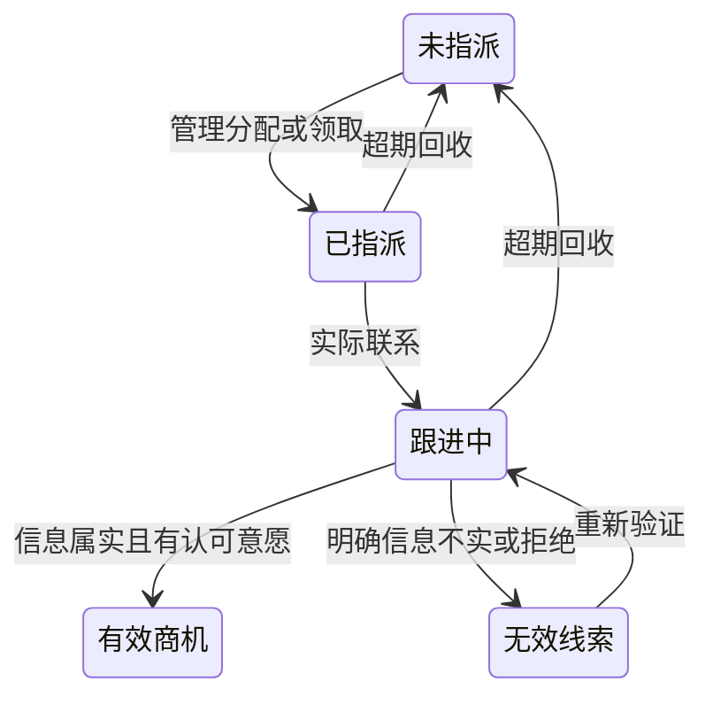

# 02 · 闭环一：线索获取与验证

## 1. 目标与角色

把可追踪的线索转化为有效商机。销售从录入到验证自行推进，管理人员负责分配、改派、重复裁决、回收及团队过程管理。

| 操作 | 销售人员 | 管理人员 |
|---|---|---|
| 录入线索 | 可以，默认归属本人 | 可以 |
| 查看、编辑与跟进 | 本人负责的记录 | 团队范围 |
| 分配、改派、回收 | 无管理权限 | 可以 |
| Excel 导入、导出、设目标 | 按接口授权限制 | 可以 |
| 查看来源和团队指标 | 个人范围 | 团队范围 |
| 系统用户、字典及软删除 | 不开放 | 不因管理角色自动获得管理员权限 |

权限实现见 `backend/app/core/deps.py` 和 `lead_service.assert_can_edit`；不能只靠列表过滤或菜单隐藏。

## 2. 场景与入口

- 销售在 PC 快速表单录入；在 AI 对话中逐轮补齐四项资料。
- 管理人员从 Excel 导入线索，查看批次与失败明细，再分配负责人。
- 销售联系客户，记录信息核实、客户反馈和下一步。
- 销售尚未联系、联系不上或未回复时，AI 任务保留待验证；明确拒绝或信息不实才判无效。
- 管理人员查看未指派、我的、公海、疑似重复和无效等子视图。

## 3. 最小录入与扩展资料

| 字段 | 作用 | AI 最小录入 |
|---|---|---|
| name | 客户名称 | 必填 |
| source | 来源字典代码 | 必填 |
| contact_name | 联系人姓名或明确称谓 | 必填 |
| contact_position | 完整职位，保留部门职责 | 必填 |
| province / city / district | 地址与地区统计 | 允许补充 |
| org_type | 机构类型 | 允许补充 |
| phone / wechat | 直接联系方式 | 线索录入不要求；阶段一标准另行核对 |
| project_name | 同客户多个项目的名称 | 按实际需要补充 |
| channel_unit / referrer | 渠道报备单位、介绍人 | 对应来源时记录 |

已知信息不重复问；每轮只追问一个必要缺口。来源不明确时不能从联系人身份猜渠道。四项录入成功与验证成功分别给回执。

## 4. 来源字典

| 代码 | 来源 | 说明 |
|---|---|---|
| company_pool | 公司客户池 | 已有客户/线索 |
| referral | 客户转介绍 | 客户相关人员介绍 |
| channel_partner | 渠道商 | 合作伙伴、集成商等非目标客户 |
| internal_referral | 内部人员介绍 | 同事及方案人员等 |
| association | 协会/机构 | 机构活动或关系 |
| market_event | 市场活动 | 展会、论坛等 |
| public_data | 公开数据平台 | 合规取得的公开线索 |
| telecom_operator | 运营商 | 运营商渠道 |

“自主拓展”是行为，不新增为来源。维护位置为 `models/enums.py`、`core/dicts.py` 及前端来源显示。

## 5. 查重与归属

录入前可调用 `/leads/check-duplicate`。普通表单可提示重复并保留疑似标记，由管理者裁决；AI 四项录入发现同名对象时先要求从有权限列表选择，不静默合并或重复创建。两条入口的处理方式不同，适配时需同时检查。

销售新录入默认归本人；公海领取或管理分配确定归属。改派保留原/新负责人、操作者、时间与说明。回收后原负责人可按权限查看历史，不因历史归属自动获得编辑权。

## 6. 生命周期

AI 任务的 `validation_state=pending/valid/invalid` 与 Lead 的生命周期状态分别保存。转化后同一 Lead 进入阶段一，不新建另一张商机主表。

## 7. 验证条件与现有入口差异

| 联系事实 | AI 验证结果 | 处理 |
|---|---|---|
| 未联系、未回复、信息结论未知 | pending | 保留线索，继续必要追问 |
| 客户信息属实，且同意下一步汇报交流 | valid | 转为有效商机 |
| 客户信息属实，且微信交流并查看我方资料 | valid | 转为有效商机 |
| 明确信息不实或明确拒绝 | invalid | 保留无效与来源历史 |
| 仅销售计划拜访、仅添加微信 | 不能直接证明有效 | 不推断客户同意 |

已有意愿但未核实信息时，必须继续问“客户和联系人信息是否属实”，短答承接同次验证，不能丢失已知意愿。

**现有表单跟进接口仍有不同口径**：`followup_service.judge_validity` 返回有效/无效二态，未说明核实、未取得两类意愿或填写其他动作会返回无效；AI 入口在 `assistant_leads.apply` 保留三态。这不是统一三态已覆盖所有入口的声明。行业适配应同时评审这两个执行点，不能只改 Prompt。

## 8. 跟进、预约与工作日

- 联系方式覆盖电话、微信、拜访、线上会议；发生日期与系统录入时间分开。
- 首次跟进期限按一个工作日计算；连续七个工作日未跟进进入回收扫描。
- 周末与配置节假日排除，调休工作日按配置计入；寒暑假不单独排除。
- 客户明确约定并经销售核实的下次联系时间可承接预约等待；销售自己的计划不等于客户预约。
- 预约等待期间的回收暂停、到期后重新起算和提醒由 `sla_service.py`、`calendar_service.py` 及领域写入处理，模型不代替日历计算。
- 转成有效商机后停止线索回收；正常商机只允许管理改派，不继续自动回收。

## 9. 待办、修改与审计

明确的下一步进入行动/提醒并关联线索。补答更新原任务；更正时间更新原行动并保留来源；请求重试不重复创建。有效跟进先保存，有争议的状态或金额操作单独暂停。验证历史和无效后重新联系都应保留。

## 10. 导入与数据校验

`import_service.py` 提供模板、列名别名、来源映射和逐行校验；`/imports/leads` 接收文件，`/imports/batches` 查看批次。错误行需能定位，不把整批失败说成成功。导入和 AI 都应调用已有领域服务，禁止适配器直接绕过权限与归属写表。

## 11. 指标与管理

线索新增趋势、来源分布/有效率、漏斗、个人产出、目标达成和跟进时效分别由 dashboard、target 与 SLA 服务提供。有效率须说明分母、时间范围与数据范围；不把“录入量”当“已核实商机量”。

## 12. 转商机交接

转化保留 Lead、联系人、来源、转化前跟进及意愿证据，创建阶段一流转和必要进度记录；后续切到项目跟进。线索历史只保留历史与商机入口，不继续展示整套验证表单。

## 13. 代码与验证定位

| 能力 | 代码 |
|---|---|
| API 与列表/录入/导入 | `backend/app/api/leads.py` |
| 查重、归属、转商机 | `backend/app/services/lead_service.py` |
| 表单有效性判定 | `backend/app/services/followup_service.py` |
| AI 提取和领域执行 | `backend/app/ai/lead_intake.py`、`services/assistant_leads.py` |
| 预约、日历和回收 | `backend/app/services/sla_service.py`、`calendar_service.py` |
| PC 入口 | `web/src/pages/LeadQuickCreate.tsx`、`LeadSimpleList.tsx`、`LeadSimpleDetail.tsx` |
| 对话规则 | [线索录入与验证 Skill](../skills/lead-intake-validation/SKILL.md) |

回归用例覆盖四项分轮录入、预约后核实属实、肯定/否定短答、状态转换及幂等。完整人工走查见 [演示案例](../../docs/展示案例.md)。
