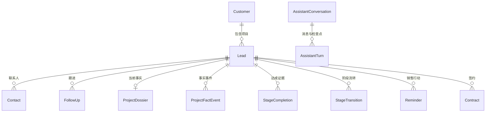

# 05 · 实际数据模型与字段字典

本文从随包 SQLAlchemy 模型生成，展示表、列、类型、可空、索引与唯一约束，不包含任何运行数据。字段和服务端校验共同构成契约，表结构不能代替业务规则。

## 1. 业务关系

图中是业务关联；当前模型多数使用标识列与服务校验关联，没有全部建立数据库外键，不应把图误读为数据库已自动执行所有引用约束。

## 2. 持久化约定

- 主键为应用生成的字符串标识，时间戳由模型公共混入提供。
- 金额为整数分；预算、合同与回款分别保存，变更另记历史。
- 项目档案 JSON 保存当前事实和来源，ProjectFactEvent 保存发生日期与跟进引用。
- 原始事实与模型候选、采纳结果及操作回执分别存储。
- 状态、枚举和 JSON 结构还需核对 Schema、服务及 AI 契约。
- 合同/交接共用表用于销售签约衔接。其余交付运营共用表保留在模型层，但没有独立展示业务入口。

## 3. 逐表字段

### ai_assistant_conversation · AssistantConversation

来源：`backend/app/models/assistant.py`；类别：业务与系统模型。

| 列 | SQL类型 | 可空 | 主键 | 索引 | 唯一 |
|---|---|---|---|---|---|
| owner_id | VARCHAR(36) | 否 |  | 是 |  |
| lead_id | VARCHAR(36) | 是 |  |  |  |
| task | JSON | 否 |  |  |  |
| suspended_tasks | JSON | 否 |  |  |  |
| revision | INTEGER | 否 |  |  |  |
| active_request | VARCHAR(100) | 是 |  |  |  |
| processing_since | DATETIME | 是 |  |  |  |
| id | VARCHAR(36) | 否 | 是 |  |  |
| created_at | DATETIME | 否 |  |  |  |
| updated_at | DATETIME | 否 |  |  |  |

### ai_assistant_turn · AssistantTurn

来源：`backend/app/models/assistant.py`；类别：业务与系统模型。

| 列 | SQL类型 | 可空 | 主键 | 索引 | 唯一 |
|---|---|---|---|---|---|
| conversation_id | VARCHAR(36) | 否 |  | 是 |  |
| request_key | VARCHAR(100) | 否 |  |  |  |
| content | TEXT | 否 |  |  |  |
| requested_lead_id | VARCHAR(36) | 是 |  |  |  |
| status | VARCHAR(20) | 否 |  |  |  |
| result | JSON | 是 |  |  |  |
| error | VARCHAR(300) | 是 |  |  |  |
| checkpoint | JSON | 是 |  |  |  |
| id | VARCHAR(36) | 否 | 是 |  |  |
| created_at | DATETIME | 否 |  |  |  |
| updated_at | DATETIME | 否 |  |  |  |

### ai_diagnosis · AiDiagnosis

来源：`backend/app/models/ai.py`；类别：业务与系统模型。

| 列 | SQL类型 | 可空 | 主键 | 索引 | 唯一 |
|---|---|---|---|---|---|
| lead_id | VARCHAR(36) | 否 |  | 是 |  |
| lead_name | VARCHAR(128) | 否 |  |  |  |
| stage | VARCHAR(32) | 是 |  |  |  |
| trigger | VARCHAR(32) | 否 |  |  |  |
| content | TEXT | 否 |  |  |  |
| structured | JSON | 是 |  |  |  |
| adopted | BOOLEAN | 是 |  |  |  |
| created_by | VARCHAR(36) | 否 |  | 是 |  |
| created_by_name | VARCHAR(64) | 否 |  |  |  |
| parse_mode | VARCHAR(16) | 否 |  |  |  |
| model_used | VARCHAR(64) | 是 |  |  |  |
| id | VARCHAR(36) | 否 | 是 |  |  |
| created_at | DATETIME | 否 |  |  |  |
| updated_at | DATETIME | 否 |  |  |  |

### ai_draft · AiDraft

来源：`backend/app/models/ai.py`；类别：业务与系统模型。

| 列 | SQL类型 | 可空 | 主键 | 索引 | 唯一 |
|---|---|---|---|---|---|
| source_message | TEXT | 否 |  |  |  |
| channel | VARCHAR(16) | 否 |  |  |  |
| im_message_id | VARCHAR(36) | 是 |  |  |  |
| lead_id | VARCHAR(36) | 是 |  | 是 |  |
| lead_name | VARCHAR(128) | 是 |  |  |  |
| match_confidence | DOUBLE | 否 |  |  |  |
| match_candidates | JSON | 否 |  |  |  |
| summary | TEXT | 否 |  |  |  |
| payload | JSON | 否 |  |  |  |
| status | VARCHAR(16) | 否 |  | 是 |  |
| created_by | VARCHAR(36) | 否 |  | 是 |  |
| created_by_name | VARCHAR(64) | 否 |  |  |  |
| confirmed_by | VARCHAR(36) | 是 |  |  |  |
| confirmed_by_name | VARCHAR(64) | 是 |  |  |  |
| confirmed_at | DATETIME | 是 |  |  |  |
| apply_result | JSON | 是 |  |  |  |
| parse_mode | VARCHAR(16) | 否 |  |  |  |
| model_used | VARCHAR(64) | 是 |  |  |  |
| id | VARCHAR(36) | 否 | 是 |  |  |
| created_at | DATETIME | 否 |  |  |  |
| updated_at | DATETIME | 否 |  |  |  |

### biz_acceptance · AcceptanceRecord

来源：`backend/app/models/delivery.py`；类别：销售签约共用。

| 列 | SQL类型 | 可空 | 主键 | 索引 | 唯一 |
|---|---|---|---|---|---|
| contract_id | VARCHAR(36) | 否 |  | 是 |  |
| lead_id | VARCHAR(36) | 否 |  | 是 |  |
| customer_name | VARCHAR(128) | 否 |  |  |  |
| status | VARCHAR(16) | 否 |  | 是 |  |
| apply_date | DATE | 是 |  |  |  |
| meeting_date | DATE | 是 |  |  |  |
| result | VARCHAR(16) | 是 |  |  |  |
| signed_date | DATE | 是 |  |  |  |
| attachment | VARCHAR(255) | 是 |  |  |  |
| rectify_note | TEXT | 是 |  |  |  |
| remark | TEXT | 是 |  |  |  |
| id | VARCHAR(36) | 否 | 是 |  |  |
| created_at | DATETIME | 否 |  |  |  |
| updated_at | DATETIME | 否 |  |  |  |

### biz_amount_change · AmountChange

来源：`backend/app/models/stage.py`；类别：业务与系统模型。

| 列 | SQL类型 | 可空 | 主键 | 索引 | 唯一 |
|---|---|---|---|---|---|
| lead_id | VARCHAR(36) | 否 |  | 是 |  |
| before_fen | INTEGER | 否 |  |  |  |
| after_fen | INTEGER | 否 |  |  |  |
| reason | TEXT | 否 |  |  |  |
| stage | VARCHAR(32) | 是 |  |  |  |
| operator_id | VARCHAR(36) | 否 |  |  |  |
| operator_name | VARCHAR(64) | 否 |  |  |  |
| source | VARCHAR(16) | 否 |  |  |  |
| id | VARCHAR(36) | 否 | 是 |  |  |
| created_at | DATETIME | 否 |  |  |  |
| updated_at | DATETIME | 否 |  |  |  |

### biz_assignment · Assignment

来源：`backend/app/models/activity.py`；类别：业务与系统模型。

| 列 | SQL类型 | 可空 | 主键 | 索引 | 唯一 |
|---|---|---|---|---|---|
| lead_id | VARCHAR(36) | 否 |  | 是 |  |
| action | VARCHAR(16) | 否 |  |  |  |
| from_owner_id | VARCHAR(36) | 是 |  |  |  |
| from_owner_name | VARCHAR(64) | 是 |  |  |  |
| to_owner_id | VARCHAR(36) | 是 |  |  |  |
| to_owner_name | VARCHAR(64) | 是 |  |  |  |
| operator_id | VARCHAR(36) | 否 |  |  |  |
| operator_name | VARCHAR(64) | 否 |  |  |  |
| remark | TEXT | 是 |  |  |  |
| id | VARCHAR(36) | 否 | 是 |  |  |
| created_at | DATETIME | 否 |  |  |  |
| updated_at | DATETIME | 否 |  |  |  |

### biz_assistant_action · AssistantAction

来源：`backend/app/models/dossier.py`；类别：业务与系统模型。

| 列 | SQL类型 | 可空 | 主键 | 索引 | 唯一 |
|---|---|---|---|---|---|
| lead_id | VARCHAR(36) | 否 |  | 是 |  |
| owner_id | VARCHAR(36) | 否 |  | 是 |  |
| origin | VARCHAR(120) | 否 |  |  | 是 |
| content | VARCHAR(500) | 否 |  |  |  |
| due_at | DATETIME | 是 |  |  |  |
| customer_confirmed | BOOLEAN | 否 |  |  |  |
| status | VARCHAR(16) | 否 |  |  |  |
| completed_at | DATETIME | 是 |  |  |  |
| effect | TEXT | 是 |  |  |  |
| history | JSON | 否 |  |  |  |
| id | VARCHAR(36) | 否 | 是 |  |  |
| created_at | DATETIME | 否 |  |  |  |
| updated_at | DATETIME | 否 |  |  |  |

### biz_complaint · Complaint

来源：`backend/app/models/operation.py`；类别：共用扩展模型。

| 列 | SQL类型 | 可空 | 主键 | 索引 | 唯一 |
|---|---|---|---|---|---|
| lead_id | VARCHAR(36) | 否 |  | 是 |  |
| contract_id | VARCHAR(36) | 是 |  |  |  |
| customer_name | VARCHAR(128) | 否 |  |  |  |
| complainant | VARCHAR(64) | 是 |  |  |  |
| receiver_id | VARCHAR(36) | 否 |  |  |  |
| receiver_name | VARCHAR(64) | 否 |  |  |  |
| received_at | DATETIME | 否 |  | 是 |  |
| content | TEXT | 否 |  |  |  |
| reason | VARCHAR(16) | 否 |  | 是 |  |
| status | VARCHAR(16) | 否 |  | 是 |  |
| handle_result | TEXT | 是 |  |  |  |
| closed_at | DATETIME | 是 |  |  |  |
| escalated | BOOLEAN | 否 |  |  |  |
| remark | TEXT | 是 |  |  |  |
| id | VARCHAR(36) | 否 | 是 |  |  |
| created_at | DATETIME | 否 |  |  |  |
| updated_at | DATETIME | 否 |  |  |  |

### biz_contact · Contact

来源：`backend/app/models/lead.py`；类别：业务与系统模型。

| 列 | SQL类型 | 可空 | 主键 | 索引 | 唯一 |
|---|---|---|---|---|---|
| lead_id | VARCHAR(36) | 否 |  | 是 |  |
| name | VARCHAR(64) | 否 |  |  |  |
| position | VARCHAR(64) | 是 |  |  |  |
| phone | VARCHAR(32) | 否 |  |  |  |
| wechat | VARCHAR(64) | 是 |  |  |  |
| is_primary | BOOLEAN | 否 |  |  |  |
| remark | TEXT | 是 |  |  |  |
| id | VARCHAR(36) | 否 | 是 |  |  |
| created_at | DATETIME | 否 |  |  |  |
| updated_at | DATETIME | 否 |  |  |  |

### biz_contract · Contract

来源：`backend/app/models/delivery.py`；类别：销售签约共用。

| 列 | SQL类型 | 可空 | 主键 | 索引 | 唯一 |
|---|---|---|---|---|---|
| lead_id | VARCHAR(36) | 否 |  | 是 |  |
| customer_name | VARCHAR(128) | 否 |  |  |  |
| contract_no | VARCHAR(64) | 否 |  | 是 |  |
| amount_fen | INTEGER | 否 |  |  |  |
| sign_date | DATE | 是 |  |  |  |
| service_start | DATE | 是 |  |  |  |
| service_end | DATE | 是 |  | 是 |  |
| acceptance_standard | TEXT | 是 |  |  |  |
| has_hardware | BOOLEAN | 否 |  |  |  |
| attachment | VARCHAR(255) | 是 |  |  |  |
| status | VARCHAR(20) | 否 |  | 是 |  |
| sales_owner_id | VARCHAR(36) | 是 |  |  |  |
| sales_owner_name | VARCHAR(64) | 是 |  |  |  |
| delivery_owner_id | VARCHAR(36) | 是 |  | 是 |  |
| delivery_owner_name | VARCHAR(64) | 是 |  |  |  |
| current_phase | INTEGER | 否 |  | 是 |  |
| phase_entered_at | DATETIME | 是 |  |  |  |
| remark | TEXT | 是 |  |  |  |
| id | VARCHAR(36) | 否 | 是 |  |  |
| created_at | DATETIME | 否 |  |  |  |
| updated_at | DATETIME | 否 |  |  |  |

### biz_customer · Customer

来源：`backend/app/models/customer.py`；类别：业务与系统模型。

| 列 | SQL类型 | 可空 | 主键 | 索引 | 唯一 |
|---|---|---|---|---|---|
| name | VARCHAR(128) | 否 |  | 是 |  |
| province | VARCHAR(32) | 否 |  |  |  |
| city | VARCHAR(32) | 否 |  |  |  |
| district | VARCHAR(32) | 否 |  |  |  |
| org_type | VARCHAR(32) | 否 |  |  |  |
| owner_id | VARCHAR(36) | 是 |  | 是 |  |
| owner_name | VARCHAR(64) | 是 |  |  |  |
| level | VARCHAR(8) | 是 |  |  |  |
| remark | TEXT | 是 |  |  |  |
| created_from | VARCHAR(16) | 否 |  |  |  |
| id | VARCHAR(36) | 否 | 是 |  |  |
| created_at | DATETIME | 否 |  |  |  |
| updated_at | DATETIME | 否 |  |  |  |

### biz_delivery_item · DeliveryItem

来源：`backend/app/models/delivery.py`；类别：销售签约共用。

| 列 | SQL类型 | 可空 | 主键 | 索引 | 唯一 |
|---|---|---|---|---|---|
| contract_id | VARCHAR(36) | 否 |  | 是 |  |
| name | VARCHAR(128) | 否 |  |  |  |
| quantity | VARCHAR(32) | 是 |  |  |  |
| unit | VARCHAR(16) | 是 |  |  |  |
| due_date | DATE | 是 |  |  |  |
| acceptance_standard | TEXT | 是 |  |  |  |
| is_standard | BOOLEAN | 否 |  | 是 |  |
| sort_order | INTEGER | 否 |  |  |  |
| remark | TEXT | 是 |  |  |  |
| id | VARCHAR(36) | 否 | 是 |  |  |
| created_at | DATETIME | 否 |  |  |  |
| updated_at | DATETIME | 否 |  |  |  |

### biz_delivery_stage · DeliveryStage

来源：`backend/app/models/delivery.py`；类别：销售签约共用。

| 列 | SQL类型 | 可空 | 主键 | 索引 | 唯一 |
|---|---|---|---|---|---|
| contract_id | VARCHAR(36) | 否 |  | 是 |  |
| phase | INTEGER | 否 |  | 是 |  |
| standard_id | VARCHAR(36) | 否 |  | 是 |  |
| standard_content | VARCHAR(255) | 否 |  |  |  |
| is_done | BOOLEAN | 否 |  |  |  |
| evidence | TEXT | 是 |  |  |  |
| done_by | VARCHAR(36) | 是 |  |  |  |
| done_by_name | VARCHAR(64) | 是 |  |  |  |
| done_at | DATETIME | 是 |  |  |  |
| remark | TEXT | 是 |  |  |  |
| source | VARCHAR(16) | 否 |  |  |  |
| id | VARCHAR(36) | 否 | 是 |  |  |
| created_at | DATETIME | 否 |  |  |  |
| updated_at | DATETIME | 否 |  |  |  |

### biz_faq_item · FaqItem

来源：`backend/app/models/operation.py`；类别：共用扩展模型。

| 列 | SQL类型 | 可空 | 主键 | 索引 | 唯一 |
|---|---|---|---|---|---|
| question | VARCHAR(255) | 否 |  |  |  |
| answer | TEXT | 否 |  |  |  |
| category | VARCHAR(32) | 是 |  | 是 |  |
| is_standard | BOOLEAN | 否 |  |  |  |
| tags | JSON | 否 |  |  |  |
| view_count | INTEGER | 否 |  |  |  |
| updated_by_name | VARCHAR(64) | 是 |  |  |  |
| id | VARCHAR(36) | 否 | 是 |  |  |
| created_at | DATETIME | 否 |  |  |  |
| updated_at | DATETIME | 否 |  |  |  |

### biz_follow_up · FollowUp

来源：`backend/app/models/activity.py`；类别：业务与系统模型。

| 列 | SQL类型 | 可空 | 主键 | 索引 | 唯一 |
|---|---|---|---|---|---|
| lead_id | VARCHAR(36) | 是 |  | 是 |  |
| customer_id | VARCHAR(36) | 是 |  | 是 |  |
| user_id | VARCHAR(36) | 否 |  | 是 |  |
| user_name | VARCHAR(64) | 否 |  |  |  |
| method | VARCHAR(32) | 否 |  |  |  |
| followed_at | DATETIME | 否 |  | 是 |  |
| content | TEXT | 否 |  |  |  |
| is_valid | VARCHAR(16) | 是 |  |  |  |
| next_action | VARCHAR(32) | 是 |  |  |  |
| next_follow_at | DATETIME | 是 |  |  |  |
| stage | VARCHAR(32) | 是 |  |  |  |
| related_standard_id | VARCHAR(36) | 是 |  |  |  |
| source | VARCHAR(16) | 否 |  |  |  |
| info_verified | BOOLEAN | 否 |  |  |  |
| id | VARCHAR(36) | 否 | 是 |  |  |
| created_at | DATETIME | 否 |  |  |  |
| updated_at | DATETIME | 否 |  |  |  |

### biz_handover_sheet · HandoverSheet

来源：`backend/app/models/delivery.py`；类别：销售签约共用。

| 列 | SQL类型 | 可空 | 主键 | 索引 | 唯一 |
|---|---|---|---|---|---|
| contract_id | VARCHAR(36) | 否 |  | 是 | 是 |
| lead_id | VARCHAR(36) | 否 |  | 是 |  |
| customer_name | VARCHAR(128) | 否 |  |  |  |
| handover_user_id | VARCHAR(36) | 是 |  |  |  |
| handover_user_name | VARCHAR(64) | 是 |  |  |  |
| receiver_id | VARCHAR(36) | 是 |  |  |  |
| receiver_name | VARCHAR(64) | 是 |  |  |  |
| delivery_owner_id | VARCHAR(36) | 是 |  |  |  |
| delivery_owner_name | VARCHAR(64) | 是 |  |  |  |
| handover_at | DATETIME | 是 |  |  |  |
| standard_note | TEXT | 是 |  |  |  |
| nonstandard_note | TEXT | 是 |  |  |  |
| sales_confirmed | BOOLEAN | 否 |  |  |  |
| sales_confirmed_at | DATETIME | 是 |  |  |  |
| delivery_confirmed | BOOLEAN | 否 |  |  |  |
| delivery_confirmed_at | DATETIME | 是 |  |  |  |
| remark | TEXT | 是 |  |  |  |
| id | VARCHAR(36) | 否 | 是 |  |  |
| created_at | DATETIME | 否 |  |  |  |
| updated_at | DATETIME | 否 |  |  |  |

### biz_im_message · ImMessage

来源：`backend/app/models/system.py`；类别：业务与系统模型。

| 列 | SQL类型 | 可空 | 主键 | 索引 | 唯一 |
|---|---|---|---|---|---|
| platform | VARCHAR(16) | 否 |  | 是 |  |
| message_id | VARCHAR(128) | 否 |  | 是 | 是 |
| group_id | VARCHAR(128) | 是 |  |  |  |
| sender_id | VARCHAR(128) | 是 |  |  |  |
| sender_name | VARCHAR(64) | 是 |  |  |  |
| raw_text | TEXT | 否 |  |  |  |
| parse_status | VARCHAR(32) | 否 |  | 是 |  |
| parse_result | JSON | 是 |  |  |  |
| lead_id | VARCHAR(36) | 是 |  |  |  |
| received_at | DATETIME | 否 |  | 是 |  |
| id | VARCHAR(36) | 否 | 是 |  |  |
| created_at | DATETIME | 否 |  |  |  |
| updated_at | DATETIME | 否 |  |  |  |

### biz_import_batch · ImportBatch

来源：`backend/app/models/system.py`；类别：业务与系统模型。

| 列 | SQL类型 | 可空 | 主键 | 索引 | 唯一 |
|---|---|---|---|---|---|
| batch_no | VARCHAR(32) | 否 |  | 是 | 是 |
| filename | VARCHAR(255) | 否 |  |  |  |
| importer_id | VARCHAR(36) | 否 |  |  |  |
| importer_name | VARCHAR(64) | 否 |  |  |  |
| total | INTEGER | 否 |  |  |  |
| success | INTEGER | 否 |  |  |  |
| failed | INTEGER | 否 |  |  |  |
| errors | JSON | 否 |  |  |  |
| id | VARCHAR(36) | 否 | 是 |  |  |
| created_at | DATETIME | 否 |  |  |  |
| updated_at | DATETIME | 否 |  |  |  |

### biz_lead · Lead

来源：`backend/app/models/lead.py`；类别：业务与系统模型。

| 列 | SQL类型 | 可空 | 主键 | 索引 | 唯一 |
|---|---|---|---|---|---|
| customer_id | VARCHAR(36) | 是 |  | 是 |  |
| project_name | VARCHAR(128) | 是 |  |  |  |
| name | VARCHAR(128) | 否 |  | 是 |  |
| source | VARCHAR(32) | 否 |  |  |  |
| province | VARCHAR(32) | 否 |  |  |  |
| city | VARCHAR(32) | 否 |  |  |  |
| district | VARCHAR(32) | 否 |  |  |  |
| org_type | VARCHAR(32) | 否 |  |  |  |
| channel_unit | VARCHAR(128) | 是 |  |  |  |
| referrer | VARCHAR(64) | 是 |  |  |  |
| creator_id | VARCHAR(36) | 否 |  | 是 |  |
| creator_name | VARCHAR(64) | 否 |  |  |  |
| owner_id | VARCHAR(36) | 是 |  | 是 |  |
| owner_name | VARCHAR(64) | 是 |  |  |  |
| status | VARCHAR(32) | 否 |  | 是 |  |
| is_suspect_duplicate | BOOLEAN | 否 |  | 是 |  |
| duplicate_hint | VARCHAR(255) | 是 |  |  |  |
| parent_id | VARCHAR(36) | 是 |  |  |  |
| dedup_status | VARCHAR(16) | 是 |  |  |  |
| assign_at | DATETIME | 是 |  | 是 |  |
| first_follow_at | DATETIME | 是 |  |  |  |
| last_follow_at | DATETIME | 是 |  |  |  |
| valid_at | DATETIME | 是 |  |  |  |
| sign_date | DATE | 是 |  |  |  |
| first_follow_deadline | DATETIME | 是 |  | 是 |  |
| recycle_deadline | DATETIME | 是 |  | 是 |  |
| budget_amount_fen | INTEGER | 否 |  |  |  |
| contract_amount_fen | INTEGER | 否 |  |  |  |
| paid_amount_fen | INTEGER | 否 |  |  |  |
| expected_sign_date | DATE | 是 |  |  |  |
| stage_expected_date | DATE | 是 |  |  |  |
| current_stage | VARCHAR(32) | 是 |  | 是 |  |
| stage_entered_at | DATETIME | 是 |  |  |  |
| win_probability | DOUBLE | 否 |  |  |  |
| risk_types | JSON | 否 |  |  |  |
| lost_reason_types | JSON | 否 |  |  |  |
| lost_at | DATETIME | 是 |  |  |  |
| lost_remark | TEXT | 是 |  |  |  |
| deliver_handoff_status | VARCHAR(32) | 是 |  |  |  |
| remark | TEXT | 是 |  |  |  |
| is_deleted | BOOLEAN | 否 |  | 是 |  |
| deleted_at | DATETIME | 是 |  |  |  |
| id | VARCHAR(36) | 否 | 是 |  |  |
| created_at | DATETIME | 否 |  |  |  |
| updated_at | DATETIME | 否 |  |  |  |

### biz_market_target · MarketTarget

来源：`backend/app/models/activity.py`；类别：业务与系统模型。

| 列 | SQL类型 | 可空 | 主键 | 索引 | 唯一 |
|---|---|---|---|---|---|
| period_type | VARCHAR(16) | 否 |  |  |  |
| period | VARCHAR(16) | 否 |  | 是 |  |
| user_id | VARCHAR(36) | 否 |  | 是 |  |
| user_name | VARCHAR(64) | 否 |  |  |  |
| metric | VARCHAR(32) | 否 |  | 是 |  |
| target_value | DOUBLE | 否 |  |  |  |
| setter_id | VARCHAR(36) | 否 |  |  |  |
| setter_name | VARCHAR(64) | 否 |  |  |  |
| period_end | DATE | 是 |  |  |  |
| id | VARCHAR(36) | 否 | 是 |  |  |
| created_at | DATETIME | 否 |  |  |  |
| updated_at | DATETIME | 否 |  |  |  |

### biz_operation_metric · OperationMetric

来源：`backend/app/models/operation.py`；类别：共用扩展模型。

| 列 | SQL类型 | 可空 | 主键 | 索引 | 唯一 |
|---|---|---|---|---|---|
| lead_id | VARCHAR(36) | 否 |  | 是 |  |
| contract_id | VARCHAR(36) | 是 |  | 是 |  |
| customer_name | VARCHAR(128) | 否 |  |  |  |
| period_type | VARCHAR(8) | 否 |  | 是 |  |
| period | VARCHAR(16) | 否 |  | 是 |  |
| total_accounts | INTEGER | 否 |  |  |  |
| login_count | INTEGER | 否 |  |  |  |
| activity_rate | DOUBLE | 否 |  |  |  |
| upload_count | INTEGER | 否 |  |  |  |
| download_count | INTEGER | 否 |  |  |  |
| file_count | INTEGER | 否 |  |  |  |
| high_quality_file_count | INTEGER | 否 |  |  |  |
| source | VARCHAR(32) | 否 |  |  |  |
| batch_no | VARCHAR(40) | 是 |  | 是 |  |
| imported_by_id | VARCHAR(36) | 是 |  |  |  |
| imported_by_name | VARCHAR(64) | 是 |  |  |  |
| id | VARCHAR(36) | 否 | 是 |  |  |
| created_at | DATETIME | 否 |  |  |  |
| updated_at | DATETIME | 否 |  |  |  |

### biz_operation_record · OperationRecord

来源：`backend/app/models/operation.py`；类别：共用扩展模型。

| 列 | SQL类型 | 可空 | 主键 | 索引 | 唯一 |
|---|---|---|---|---|---|
| lead_id | VARCHAR(36) | 否 |  | 是 |  |
| contract_id | VARCHAR(36) | 是 |  | 是 |  |
| customer_name | VARCHAR(128) | 否 |  |  |  |
| record_date | DATE | 否 |  | 是 |  |
| action_type | VARCHAR(24) | 否 |  | 是 |  |
| content | TEXT | 否 |  |  |  |
| next_plan | TEXT | 是 |  |  |  |
| status | VARCHAR(16) | 否 |  | 是 |  |
| satisfaction | VARCHAR(32) | 是 |  |  |  |
| executor_id | VARCHAR(36) | 否 |  |  |  |
| executor_name | VARCHAR(64) | 否 |  |  |  |
| source | VARCHAR(16) | 否 |  |  |  |
| batch_no | VARCHAR(40) | 是 |  | 是 |  |
| id | VARCHAR(36) | 否 | 是 |  |  |
| created_at | DATETIME | 否 |  |  |  |
| updated_at | DATETIME | 否 |  |  |  |

### biz_payment_record · PaymentRecord

来源：`backend/app/models/report.py`；类别：业务与系统模型。

| 列 | SQL类型 | 可空 | 主键 | 索引 | 唯一 |
|---|---|---|---|---|---|
| lead_id | VARCHAR(36) | 否 |  | 是 |  |
| lead_name | VARCHAR(128) | 否 |  |  |  |
| amount_fen | INTEGER | 否 |  |  |  |
| paid_date | DATE | 否 |  | 是 |  |
| method | VARCHAR(32) | 是 |  |  |  |
| period_no | VARCHAR(32) | 是 |  |  |  |
| remark | TEXT | 是 |  |  |  |
| operator_id | VARCHAR(36) | 否 |  |  |  |
| operator_name | VARCHAR(64) | 否 |  |  |  |
| id | VARCHAR(36) | 否 | 是 |  |  |
| created_at | DATETIME | 否 |  |  |  |
| updated_at | DATETIME | 否 |  |  |  |

### biz_product_issue · ProductIssue

来源：`backend/app/models/operation.py`；类别：共用扩展模型。

| 列 | SQL类型 | 可空 | 主键 | 索引 | 唯一 |
|---|---|---|---|---|---|
| lead_id | VARCHAR(36) | 否 |  | 是 |  |
| contract_id | VARCHAR(36) | 是 |  |  |  |
| customer_name | VARCHAR(128) | 否 |  |  |  |
| type | VARCHAR(16) | 否 |  | 是 |  |
| content | TEXT | 否 |  |  |  |
| source | VARCHAR(16) | 否 |  | 是 |  |
| proposer | VARCHAR(64) | 是 |  |  |  |
| registrar_id | VARCHAR(36) | 否 |  |  |  |
| registrar_name | VARCHAR(64) | 否 |  |  |  |
| registered_at | DATETIME | 否 |  | 是 |  |
| handler_side | VARCHAR(16) | 否 |  | 是 |  |
| assignee_id | VARCHAR(36) | 是 |  |  |  |
| assignee_name | VARCHAR(64) | 是 |  |  |  |
| due_date | DATE | 是 |  |  |  |
| status | VARCHAR(16) | 否 |  | 是 |  |
| promised_date | DATE | 是 |  |  |  |
| resolved_at | DATETIME | 是 |  |  |  |
| replied_at | DATETIME | 是 |  |  |  |
| solution | TEXT | 是 |  |  |  |
| reply_note | TEXT | 是 |  |  |  |
| reply_channel | VARCHAR(16) | 否 |  |  |  |
| reply_target | VARCHAR(64) | 否 |  |  |  |
| reply_evidence | TEXT | 否 |  |  |  |
| is_renewal_risk | BOOLEAN | 否 |  | 是 |  |
| remark | TEXT | 是 |  |  |  |
| id | VARCHAR(36) | 否 | 是 |  |  |
| created_at | DATETIME | 否 |  |  |  |
| updated_at | DATETIME | 否 |  |  |  |

### biz_project_dossier · ProjectDossier

来源：`backend/app/models/dossier.py`；类别：业务与系统模型。

| 列 | SQL类型 | 可空 | 主键 | 索引 | 唯一 |
|---|---|---|---|---|---|
| lead_id | VARCHAR(36) | 否 |  | 是 | 是 |
| revision | INTEGER | 否 |  |  |  |
| facts | JSON | 否 |  |  |  |
| evidence | JSON | 否 |  |  |  |
| id | VARCHAR(36) | 否 | 是 |  |  |
| created_at | DATETIME | 否 |  |  |  |
| updated_at | DATETIME | 否 |  |  |  |

### biz_project_fact_event · ProjectFactEvent

来源：`backend/app/models/dossier.py`；类别：业务与系统模型。

| 列 | SQL类型 | 可空 | 主键 | 索引 | 唯一 |
|---|---|---|---|---|---|
| lead_id | VARCHAR(36) | 否 |  | 是 |  |
| turn_id | VARCHAR(36) | 否 |  |  | 是 |
| owner_id | VARCHAR(36) | 否 |  |  |  |
| occurred_at | DATETIME | 否 |  |  |  |
| content | TEXT | 否 |  |  |  |
| changes | JSON | 否 |  |  |  |
| record | JSON | 否 |  |  |  |
| followup_id | VARCHAR(36) | 是 |  |  |  |
| id | VARCHAR(36) | 否 | 是 |  |  |
| created_at | DATETIME | 否 |  |  |  |
| updated_at | DATETIME | 否 |  |  |  |

### biz_project_review · ProjectReview

来源：`backend/app/models/report.py`；类别：业务与系统模型。

| 列 | SQL类型 | 可空 | 主键 | 索引 | 唯一 |
|---|---|---|---|---|---|
| lead_id | VARCHAR(36) | 否 |  | 是 |  |
| lead_name | VARCHAR(128) | 否 |  |  |  |
| stage | VARCHAR(32) | 是 |  |  |  |
| reviewer_id | VARCHAR(36) | 否 |  | 是 |  |
| reviewer_name | VARCHAR(64) | 否 |  |  |  |
| review_at | DATETIME | 否 |  | 是 |  |
| m1_decision_maker | JSON | 否 |  |  |  |
| m2_intent_budget | JSON | 否 |  |  |  |
| m3_demand_confirm | JSON | 否 |  |  |  |
| m4_stakeholders | JSON | 否 |  |  |  |
| m5_unknown_competitor | JSON | 否 |  |  |  |
| verdict | VARCHAR(16) | 否 |  | 是 |  |
| conclusion | VARCHAR(255) | 是 |  |  |  |
| next_review_at | DATE | 是 |  |  |  |
| remark | TEXT | 是 |  |  |  |
| id | VARCHAR(36) | 否 | 是 |  |  |
| created_at | DATETIME | 否 |  |  |  |
| updated_at | DATETIME | 否 |  |  |  |

### biz_reminder · Reminder

来源：`backend/app/models/activity.py`；类别：业务与系统模型。

| 列 | SQL类型 | 可空 | 主键 | 索引 | 唯一 |
|---|---|---|---|---|---|
| lead_id | VARCHAR(36) | 是 |  | 是 |  |
| lead_name | VARCHAR(128) | 是 |  |  |  |
| type | VARCHAR(32) | 否 |  | 是 |  |
| content | VARCHAR(255) | 否 |  |  |  |
| remind_at | DATETIME | 否 |  | 是 |  |
| receiver_id | VARCHAR(36) | 否 |  | 是 |  |
| receiver_name | VARCHAR(64) | 否 |  |  |  |
| status | VARCHAR(16) | 否 |  | 是 |  |
| done_at | DATETIME | 是 |  |  |  |
| done_by | VARCHAR(36) | 是 |  |  |  |
| source_diagnosis_id | VARCHAR(36) | 是 |  |  |  |
| source_action_index | INTEGER | 是 |  |  |  |
| source_suggestion | TEXT | 是 |  |  |  |
| completion_followup_id | VARCHAR(36) | 是 |  |  |  |
| dedup_key | VARCHAR(128) | 否 |  | 是 | 是 |
| id | VARCHAR(36) | 否 | 是 |  |  |
| created_at | DATETIME | 否 |  |  |  |
| updated_at | DATETIME | 否 |  |  |  |

### biz_renewal_assessment · RenewalAssessment

来源：`backend/app/models/delivery.py`；类别：销售签约共用。

| 列 | SQL类型 | 可空 | 主键 | 索引 | 唯一 |
|---|---|---|---|---|---|
| contract_id | VARCHAR(36) | 否 |  | 是 |  |
| lead_id | VARCHAR(36) | 否 |  | 是 |  |
| customer_name | VARCHAR(128) | 否 |  |  |  |
| owner_name | VARCHAR(64) | 是 |  |  |  |
| service_end | DATE | 是 |  |  |  |
| assess_date | DATE | 是 |  |  |  |
| activity_note | VARCHAR(255) | 是 |  |  |  |
| satisfaction | VARCHAR(32) | 是 |  |  |  |
| acceptance_result | VARCHAR(16) | 是 |  |  |  |
| willingness | VARCHAR(16) | 否 |  |  |  |
| plan_note | TEXT | 是 |  |  |  |
| conclusion | TEXT | 是 |  |  |  |
| expected_amount_fen | INTEGER | 否 |  |  |  |
| status | VARCHAR(16) | 否 |  | 是 |  |
| assessed_by | VARCHAR(36) | 是 |  |  |  |
| assessed_by_name | VARCHAR(64) | 是 |  |  |  |
| id | VARCHAR(36) | 否 | 是 |  |  |
| created_at | DATETIME | 否 |  |  |  |
| updated_at | DATETIME | 否 |  |  |  |

### biz_risk_alert · RiskAlert

来源：`backend/app/models/stage.py`；类别：业务与系统模型。

| 列 | SQL类型 | 可空 | 主键 | 索引 | 唯一 |
|---|---|---|---|---|---|
| lead_id | VARCHAR(36) | 否 |  | 是 |  |
| kind | VARCHAR(24) | 否 |  | 是 |  |
| domain | VARCHAR(16) | 否 |  | 是 |  |
| risk_type | VARCHAR(32) | 否 |  | 是 |  |
| trigger_rule | VARCHAR(255) | 是 |  |  |  |
| description | TEXT | 否 |  |  |  |
| status | VARCHAR(16) | 否 |  | 是 |  |
| handler_id | VARCHAR(36) | 是 |  |  |  |
| handler_name | VARCHAR(64) | 是 |  |  |  |
| handled_at | DATETIME | 是 |  |  |  |
| handle_note | TEXT | 是 |  |  |  |
| source | VARCHAR(16) | 否 |  |  |  |
| owner_id | VARCHAR(36) | 是 |  |  |  |
| owner_name | VARCHAR(64) | 是 |  |  |  |
| dedup_key | VARCHAR(160) | 是 |  | 是 |  |
| rule_revision | VARCHAR(64) | 是 |  |  |  |
| id | VARCHAR(36) | 否 | 是 |  |  |
| created_at | DATETIME | 否 |  |  |  |
| updated_at | DATETIME | 否 |  |  |  |

### biz_stage_completion · StageCompletion

来源：`backend/app/models/stage.py`；类别：业务与系统模型。

| 列 | SQL类型 | 可空 | 主键 | 索引 | 唯一 |
|---|---|---|---|---|---|
| lead_id | VARCHAR(36) | 否 |  | 是 |  |
| stage | VARCHAR(32) | 否 |  | 是 |  |
| standard_id | VARCHAR(36) | 否 |  | 是 |  |
| standard_content | VARCHAR(255) | 否 |  |  |  |
| is_done | BOOLEAN | 否 |  |  |  |
| evidence | TEXT | 是 |  |  |  |
| done_by | VARCHAR(36) | 是 |  |  |  |
| done_by_name | VARCHAR(64) | 是 |  |  |  |
| done_at | DATETIME | 是 |  |  |  |
| remark | TEXT | 是 |  |  |  |
| source | VARCHAR(16) | 否 |  |  |  |
| id | VARCHAR(36) | 否 | 是 |  |  |
| created_at | DATETIME | 否 |  |  |  |
| updated_at | DATETIME | 否 |  |  |  |

### biz_stage_sales_confirmation · StageSalesConfirmation

来源：`backend/app/models/stage.py`；类别：业务与系统模型。

| 列 | SQL类型 | 可空 | 主键 | 索引 | 唯一 |
|---|---|---|---|---|---|
| lead_id | VARCHAR(36) | 否 |  | 是 |  |
| idempotency_key | VARCHAR(128) | 否 |  | 是 | 是 |
| request_sha256 | VARCHAR(64) | 否 |  |  |  |
| actor_id | VARCHAR(36) | 否 |  |  |  |
| actor_name | VARCHAR(64) | 否 |  |  |  |
| judgement_id | VARCHAR(36) | 否 |  |  |  |
| stage | VARCHAR(32) | 否 |  |  |  |
| dossier_revision | INTEGER | 是 |  |  |  |
| confirmation_note | TEXT | 否 |  |  |  |
| selected_items | JSON | 否 |  |  |  |
| corrections | JSON | 否 |  |  |  |
| response | JSON | 否 |  |  |  |
| id | VARCHAR(36) | 否 | 是 |  |  |
| created_at | DATETIME | 否 |  |  |  |
| updated_at | DATETIME | 否 |  |  |  |

### biz_stage_transition · StageTransition

来源：`backend/app/models/stage.py`；类别：业务与系统模型。

| 列 | SQL类型 | 可空 | 主键 | 索引 | 唯一 |
|---|---|---|---|---|---|
| lead_id | VARCHAR(36) | 否 |  | 是 |  |
| from_stage | VARCHAR(32) | 是 |  |  |  |
| to_stage | VARCHAR(32) | 否 |  |  |  |
| transition_at | DATETIME | 否 |  | 是 |  |
| operator_id | VARCHAR(36) | 否 |  |  |  |
| operator_name | VARCHAR(64) | 否 |  |  |  |
| stay_days | INTEGER | 否 |  |  |  |
| basis | TEXT | 是 |  |  |  |
| remark | TEXT | 是 |  |  |  |
| id | VARCHAR(36) | 否 | 是 |  |  |
| created_at | DATETIME | 否 |  |  |  |
| updated_at | DATETIME | 否 |  |  |  |

### biz_standard_judgement · StandardJudgement

来源：`backend/app/models/stage.py`；类别：业务与系统模型。

| 列 | SQL类型 | 可空 | 主键 | 索引 | 唯一 |
|---|---|---|---|---|---|
| lead_id | VARCHAR(36) | 否 |  | 是 |  |
| stage | VARCHAR(32) | 否 |  | 是 |  |
| judged_at | DATETIME | 否 |  |  |  |
| model_used | VARCHAR(64) | 是 |  |  |  |
| parse_mode | VARCHAR(16) | 是 |  |  |  |
| items | JSON | 否 |  |  |  |
| already_done | JSON | 否 |  |  |  |
| hard_gate_passed | BOOLEAN | 否 |  |  |  |
| missing_hard_gates | JSON | 否 |  |  |  |
| basis_followup_at | DATETIME | 是 |  |  |  |
| status | VARCHAR(16) | 否 |  | 是 |  |
| id | VARCHAR(36) | 否 | 是 |  |  |
| created_at | DATETIME | 否 |  |  |  |
| updated_at | DATETIME | 否 |  |  |  |

### biz_weekly_report · WeeklyReport

来源：`backend/app/models/report.py`；类别：业务与系统模型。

| 列 | SQL类型 | 可空 | 主键 | 索引 | 唯一 |
|---|---|---|---|---|---|
| period | VARCHAR(16) | 否 |  | 是 |  |
| period_start | DATE | 否 |  |  |  |
| period_end | DATE | 否 |  |  |  |
| user_id | VARCHAR(36) | 否 |  | 是 |  |
| user_name | VARCHAR(64) | 否 |  |  |  |
| metrics | JSON | 否 |  |  |  |
| body | TEXT | 否 |  |  |  |
| problems | TEXT | 是 |  |  |  |
| next_plan | TEXT | 是 |  |  |  |
| is_submitted | BOOLEAN | 否 |  | 是 |  |
| submitted_at | DATETIME | 是 |  |  |  |
| generated_by | VARCHAR(16) | 否 |  |  |  |
| model_used | VARCHAR(64) | 是 |  |  |  |
| id | VARCHAR(36) | 否 | 是 |  |  |
| created_at | DATETIME | 否 |  |  |  |
| updated_at | DATETIME | 否 |  |  |  |

### cfg_delivery_phase_standard · DeliveryPhaseStandard

来源：`backend/app/models/delivery.py`；类别：销售签约共用。

| 列 | SQL类型 | 可空 | 主键 | 索引 | 唯一 |
|---|---|---|---|---|---|
| phase | INTEGER | 否 |  | 是 |  |
| seq | VARCHAR(8) | 否 |  |  |  |
| content | VARCHAR(255) | 否 |  |  |  |
| is_required | BOOLEAN | 否 |  |  |  |
| duration_days | INTEGER | 否 |  |  |  |
| evidence_hint | VARCHAR(255) | 是 |  |  |  |
| sort_order | INTEGER | 否 |  |  |  |
| is_active | BOOLEAN | 否 |  |  |  |
| id | VARCHAR(36) | 否 | 是 |  |  |
| created_at | DATETIME | 否 |  |  |  |
| updated_at | DATETIME | 否 |  |  |  |

### cfg_notification_template · NotificationTemplate

来源：`backend/app/models/system.py`；类别：业务与系统模型。

| 列 | SQL类型 | 可空 | 主键 | 索引 | 唯一 |
|---|---|---|---|---|---|
| code | VARCHAR(64) | 否 |  | 是 | 是 |
| name | VARCHAR(128) | 否 |  |  |  |
| channel | VARCHAR(16) | 否 |  |  |  |
| title_tpl | VARCHAR(255) | 否 |  |  |  |
| content_tpl | TEXT | 否 |  |  |  |
| event | VARCHAR(64) | 否 |  | 是 |  |
| is_active | BOOLEAN | 否 |  |  |  |
| remark | VARCHAR(255) | 是 |  |  |  |
| id | VARCHAR(36) | 否 | 是 |  |  |
| created_at | DATETIME | 否 |  |  |  |
| updated_at | DATETIME | 否 |  |  |  |

### cfg_stage_standard · StageStandard

来源：`backend/app/models/stage.py`；类别：业务与系统模型。

| 列 | SQL类型 | 可空 | 主键 | 索引 | 唯一 |
|---|---|---|---|---|---|
| stage | VARCHAR(32) | 否 |  | 是 |  |
| seq | VARCHAR(8) | 否 |  |  |  |
| content | VARCHAR(255) | 否 |  |  |  |
| is_hard_gate | BOOLEAN | 否 |  |  |  |
| duration_days | INTEGER | 否 |  |  |  |
| evidence_hint | VARCHAR(255) | 是 |  |  |  |
| sort_order | INTEGER | 否 |  |  |  |
| is_active | BOOLEAN | 否 |  |  |  |
| id | VARCHAR(36) | 否 | 是 |  |  |
| created_at | DATETIME | 否 |  |  |  |
| updated_at | DATETIME | 否 |  |  |  |

### cfg_standard_service_item · StandardServiceItem

来源：`backend/app/models/delivery.py`；类别：销售签约共用。

| 列 | SQL类型 | 可空 | 主键 | 索引 | 唯一 |
|---|---|---|---|---|---|
| name | VARCHAR(128) | 否 |  |  |  |
| unit | VARCHAR(16) | 是 |  |  |  |
| quantity | VARCHAR(32) | 是 |  |  |  |
| acceptance_standard | TEXT | 是 |  |  |  |
| sort_order | INTEGER | 否 |  |  |  |
| is_active | BOOLEAN | 否 |  |  |  |
| id | VARCHAR(36) | 否 | 是 |  |  |
| created_at | DATETIME | 否 |  |  |  |
| updated_at | DATETIME | 否 |  |  |  |

### sys_department · Department

来源：`backend/app/models/user.py`；类别：业务与系统模型。

| 列 | SQL类型 | 可空 | 主键 | 索引 | 唯一 |
|---|---|---|---|---|---|
| name | VARCHAR(64) | 否 |  |  | 是 |
| parent_id | VARCHAR(36) | 是 |  |  |  |
| sort_order | INTEGER | 否 |  |  |  |
| leader_name | VARCHAR(64) | 是 |  |  |  |
| remark | VARCHAR(255) | 是 |  |  |  |
| id | VARCHAR(36) | 否 | 是 |  |  |
| created_at | DATETIME | 否 |  |  |  |
| updated_at | DATETIME | 否 |  |  |  |

### sys_holiday · Holiday

来源：`backend/app/models/system.py`；类别：业务与系统模型。

| 列 | SQL类型 | 可空 | 主键 | 索引 | 唯一 |
|---|---|---|---|---|---|
| day | DATE | 否 |  | 是 | 是 |
| kind | VARCHAR(20) | 否 |  |  |  |
| name | VARCHAR(32) | 是 |  |  |  |
| id | VARCHAR(36) | 否 | 是 |  |  |
| created_at | DATETIME | 否 |  |  |  |
| updated_at | DATETIME | 否 |  |  |  |

### sys_notification · Notification

来源：`backend/app/models/system.py`；类别：业务与系统模型。

| 列 | SQL类型 | 可空 | 主键 | 索引 | 唯一 |
|---|---|---|---|---|---|
| user_id | VARCHAR(36) | 否 |  | 是 |  |
| title | VARCHAR(128) | 否 |  |  |  |
| content | TEXT | 否 |  |  |  |
| type | VARCHAR(32) | 否 |  |  |  |
| is_read | BOOLEAN | 否 |  | 是 |  |
| biz_type | VARCHAR(32) | 是 |  |  |  |
| biz_id | VARCHAR(36) | 是 |  |  |  |
| id | VARCHAR(36) | 否 | 是 |  |  |
| created_at | DATETIME | 否 |  |  |  |
| updated_at | DATETIME | 否 |  |  |  |

### sys_operation_log · OperationLog

来源：`backend/app/models/system.py`；类别：业务与系统模型。

| 列 | SQL类型 | 可空 | 主键 | 索引 | 唯一 |
|---|---|---|---|---|---|
| operator_id | VARCHAR(36) | 否 |  | 是 |  |
| operator_name | VARCHAR(64) | 否 |  |  |  |
| action | VARCHAR(32) | 否 |  | 是 |  |
| target_type | VARCHAR(32) | 否 |  |  |  |
| target_id | VARCHAR(36) | 是 |  |  |  |
| target_name | VARCHAR(128) | 是 |  |  |  |
| detail | TEXT | 是 |  |  |  |
| ip | VARCHAR(64) | 是 |  |  |  |
| id | VARCHAR(36) | 否 | 是 |  |  |
| created_at | DATETIME | 否 |  |  |  |
| updated_at | DATETIME | 否 |  |  |  |

### sys_rule_config · RuleConfig

来源：`backend/app/models/report.py`；类别：业务与系统模型。

| 列 | SQL类型 | 可空 | 主键 | 索引 | 唯一 |
|---|---|---|---|---|---|
| key | VARCHAR(64) | 否 |  | 是 | 是 |
| value | VARCHAR(255) | 否 |  |  |  |
| value_type | VARCHAR(16) | 否 |  |  |  |
| label | VARCHAR(64) | 否 |  |  |  |
| group | VARCHAR(32) | 否 |  | 是 |  |
| unit | VARCHAR(16) | 是 |  |  |  |
| description | VARCHAR(255) | 是 |  |  |  |
| sort_order | INTEGER | 否 |  |  |  |
| id | VARCHAR(36) | 否 | 是 |  |  |
| created_at | DATETIME | 否 |  |  |  |
| updated_at | DATETIME | 否 |  |  |  |

### sys_user · User

来源：`backend/app/models/user.py`；类别：业务与系统模型。

| 列 | SQL类型 | 可空 | 主键 | 索引 | 唯一 |
|---|---|---|---|---|---|
| username | VARCHAR(64) | 否 |  | 是 | 是 |
| name | VARCHAR(64) | 否 |  |  |  |
| password_hash | VARCHAR(255) | 否 |  |  |  |
| role | VARCHAR(32) | 否 |  |  |  |
| data_scope | VARCHAR(16) | 否 |  |  |  |
| department | VARCHAR(64) | 是 |  |  |  |
| phone | VARCHAR(32) | 是 |  |  |  |
| email | VARCHAR(128) | 是 |  |  |  |
| wecom_userid | VARCHAR(128) | 是 |  |  |  |
| dingtalk_userid | VARCHAR(128) | 是 |  |  |  |
| feishu_userid | VARCHAR(128) | 是 |  |  |  |
| is_active | BOOLEAN | 否 |  |  |  |
| id | VARCHAR(36) | 否 | 是 |  |  |
| created_at | DATETIME | 否 |  |  |  |
| updated_at | DATETIME | 否 |  |  |  |
