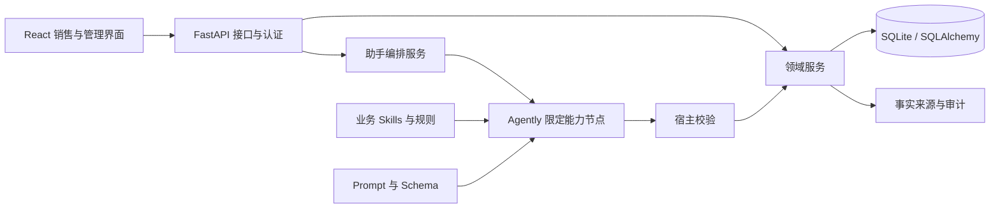

# 07 · 架构设计

## 1. 分层

## 2. 模块与职责

| 层 | 模块 | 职责 |
|---|---|---|
| 展示 | `web/src/pages`、`components` | 对话、列表、详情、依据、行动与管理页面 |
| 状态/请求 | `store/auth.ts`、`api`、React Query | Token、请求、缓存失效与错误提示 |
| 接口 | `backend/app/api` | HTTP 契约、参数、认证与角色依赖 |
| 编排 | `services/assistant_service.py` | 任务路由、节点依赖、检查点、回执及恢复 |
| 领域 | `services/lead_service.py` 等 | 归属、验证、阶段、金额、档案、行动及签约 |
| AI | `app/ai` | 框架执行、节点结构输出和校验器 |
| 方法与规则 | `spec/skills`、`core/dicts.py`、风险规则文档 | 方法、默认业务标准及内容修订 |
| 数据 | `models`、`database.py` | 表结构、异步会话及原型迁移 |
| 定时任务 | `scheduler.py` | SLA、预警及周报调度 |

## 3. 两条入口共用领域层

PC 表单与 AI 对话都调用领域服务。表单有明确字段，AI 先把自然语言变成候选，再经来源和权限校验。展示入口一致不代表所有历史分支的状态口径已统一；闭环一的二态/三态差异见 [闭环一规则](02-闭环一-线索获取与验证.md)。

## 4. 客户、项目与档案

Customer 管机构，Lead 管项目及生命周期，Contact 管沟通对象。FollowUp 是原始跟进，ProjectDossier 保存当前事实与修订，ProjectFactEvent 保留事实变化。StageCompletion 保存达成证据，StageTransition 保存阶段历史。聊天不作为唯一业务数据库。

## 5. 写入与并发

请求经鉴权后取得允许对象，读取任务/档案版本，执行限定操作。会话请求键、CAS 与领域幂等避免重复；事务提交后给实际回执。检查点拆开有效跟进与后续判断，防止一次模型失败抹掉已经保存的记录。

## 6. 关键链路

1. 线索四项 → 资料查重与归属 → 联系核实 → 转商机。
2. 跟进消息 → 上下文 → 路由与提取 → 按需金额/归属/记录核对 → 档案与跟进保存。
3. 已保存事实 → 未完成标准判断 → 候选及来源 → 人工采纳/受约束执行 → 阶段流转。
4. 主动诊断 → 五项报告 → 建议采纳 → 行动 → 执行反馈 → 再次诊断。
5. 明确签约 → 阶段门槛 → 金额和日期登记 → 合同/交接记录。

## 7. 定时与部署

单进程 asyncio 调度与 FastAPI lifespan 同步启停；SQLite WAL、忙等待和短事务适用于本地原型。多实例部署需重新设计数据库迁移、连接池、共享任务与单次调度，不把进程内定时任务复制为多个重复执行者。

## 8. 外部适配原则

模型通过 `SETTINGS.yaml` 与环境变量接入；IM/语音/CRM 通过授权适配器转为同一领域输入，不绕过 API/服务直接写表。敏感数据的外发、日志和用户授权由实际部署方负责配置和验证。
