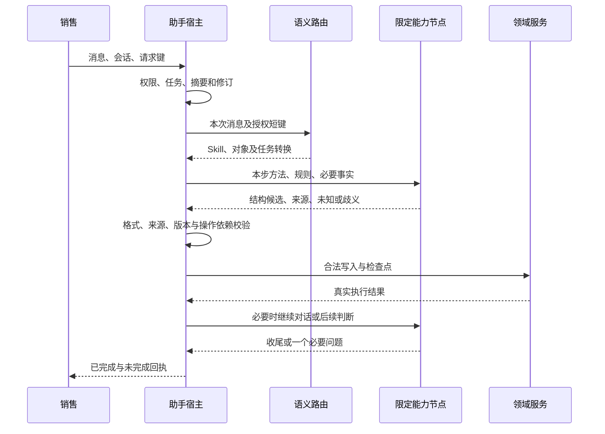

# 23 · AI 助手编排与恢复设计

## 1. 实现入口

聊天接口在 `app/api/assistant.py` 和 `assistant_workspace.py`，主编排在 `services/assistant_service.py`。`workflows/main_flow.py` 还承载结构化录入流程；不能把该旧式单流程当作全部聊天节点。

## 2. 一轮消息的数据流

## 3. 节点按需执行

路由定位任务，提取识别本轮变化，涉及金额才财务核对，存在多项目才归属复核；记录核对后保存有效事实。阶段节点读取尚未达成标准，诊断按主动请求，需求报告相关阶段按需生成或复用。调用次数随任务及失败恢复变化。

节点对应 `ai/assistant_router.py`、`assistant_facts.py`、`assistant_finance.py`、`assistant_project_attribution.py`、`assistant_record_review.py`、`assistant_stage_judge.py`、`assistant_analysis.py` 及 `lead_intake.py`。

## 4. 检查点与恢复

`AssistantConversation` 保存当前任务和 revision；`AssistantTurn` 保存 request_key、状态、检查点及响应。保存检查点与最终回复分开，避免模型失败把已成功持久化的事实重复执行。

恢复以原请求键、对象、权限和最新档案版本为基础。只恢复未成功步骤；不能把旧候选覆盖到新版本。遇并发变更先明确冲突，不能靠忽略版本继续推进。

## 5. 规则与方法交付

Skills 打包保留相对资源，框架安装生成内容修订。Prompt 定义本节点任务，Schema 定义结构，宿主提供可用来源和短键。规则文件、模型配置与运行代码是同一分发单元，缺少规则不以空内容继续。

## 6. 执行边界

主节点面向销售，从节点不独立发问；后端服务保存事实和阶段。传输重试不等于业务降级。模型失败不切换为硬编码语义判断，也不生成成功回执。

## 7. 适配验证顺序

先验证规则/Schema/Prompt 一致，再验证来源、权限、幂等与部分失败，然后用模型检查语义，最后走页面和报告导出。每批变更通过相关检查再继续，不能只比较模型最后一句话。
